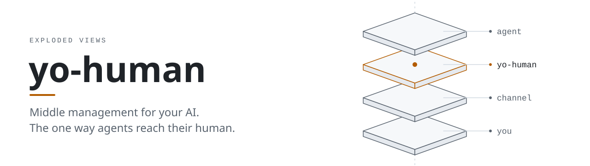
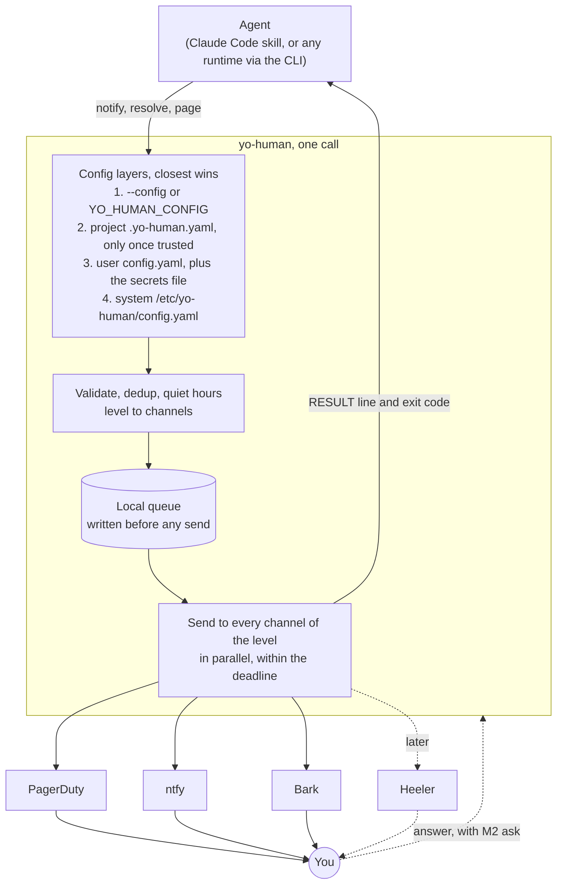

<p align="center">
  <picture>
    <source media="(prefers-color-scheme: dark)" srcset="docs/assets/yo-human-dark.svg">
    
  </picture>
</p>

<p align="center">
  <a href="https://github.com/Exploded-views/yo-human/actions/workflows/ci.yml"></a>
  <a href="LICENSE"></a>
</p>

yo-human is a Go CLI that AI agents call when they need their human: to notify, to ask, and to escalate ("yo, human!"). It delivers through the channels you configure (PagerDuty, ntfy and Bark first, Heeler later), at the level the agent picks, and return within a deadline so the agent never stalls. It runs on your machine when called. There is no daemon and no hosted service.

> [!IMPORTANT]
> **Early days.** v1 (M0 and M1) is built: `notify`, `resolve`, `flush`, `status`, `levels`, `page`, `channel test` and the config and secret commands, over PagerDuty, ntfy and Bark. It is not released yet (`v0.1.0` has no tag), so build it from source. Ask (M2) and everything after it is design, not shipped behavior.

## Why

Agents working for you sometimes need you: production is down for a reason only you can fix, a vendor's status page shows a breach and every key needs rotating, a release waits on a command only you can run. You are away from the keyboard, and the work shouldn't wait for you to come back. Today each agent reaches you its own way (a paging script here, a push topic there) with no shared rule for dedup, quiet hours or saying what it needs from you.

yo-human gives every agent one tool for this. The agent decides whether you are needed and how urgently; yo-human reaches you the way you asked to be reached.

- **Notify** (M1): tell the human something, from an FYI to "get to a screen now".
- **Escalate** (M1): resend the same incident at a louder level. It goes out at that level, and the open incident is raised, not duplicated. Escalating an unanswered question on a schedule you set comes with M3.
- **Ask** (M2): put a question to the human and return the answer to the agent that asked.

The [constitution](constitution.md) binds the design to a few promises. A message is written to a local queue before any send and leaves it only when a channel confirms delivery; sends that run out of retries go to a dead letter that `status` shows. The same dedup key at the same level is recorded, not sent twice. Every call returns within a deadline you set (default 1 s); if no channel answers in time, the message stays queued and the call exits 75. Levels, channels and quiet hours are configuration you own, and the core runs on free services. Config files name secrets but never hold them; values live in one local file at mode 0600 and are piped in on stdin.

## Usage

> [!NOTE]
> `yo-human help` lists every command. The [M1 contract](docs/specs/2026-10-26-m1-contract-design.md) has the full CLI, exit codes, config format and the `page` shim for existing PagerDuty scripts. Level names come from your config (`yo-human levels` lists them, quietest first); `heads-up` and `wake-me` are examples.

```console
$ yo-human notify --level heads-up --title "Checkout API error rate rising" \
    --ask "No action yet; watching it" --dedup-key checkout-errors
RESULT delivered 01JBQ3V5S9Z4W8K2N6M0R7T1XA

$ yo-human notify --level wake-me --title "Checkout API down" \
    --ask "Approve the rollback" --dedup-key checkout-errors
RESULT delivered 01JBQ3W2D4H8P0F6C1Y9K5E3VB

$ yo-human resolve --dedup-key checkout-errors --note "Rolled back"
RESULT resolved 01JBQ3X7M1T5G9B3J8Q2N6W4ZC
```

The first stdout line is always `RESULT <status> <id>`, and `--json` (after the command) prints one versioned object instead. Agents act on the exit code:

| Exit | Meaning | What the agent does |
|---|---|---|
| 0 | Done: `delivered`, `partial`, `held` for quiet hours, `suppressed` as a repeat, `resolved`, `noop` or `ok` | Carry on |
| 64 | The call is wrong (a bad flag, level or argument) | Fix the call |
| 69 | Failed for good: no channel can take it, or a service the call needs cannot be used | Don't retry the same call |
| 70 | Internal error in yo-human | Report it |
| 74 | The local store could not be read or written | Tell the human |
| 75 | Queued: the next call or `yo-human flush` retries it | Follow `next` |
| 78 | A config problem only the human can fix, such as a missing secret | Tell the human |



Solid lines are M1; dashed lines come later. Re-paging until someone acknowledges is left to services that already do it (PagerDuty escalation policies, ntfy scheduled delivery), because yo-human only runs when called.

## Build from source

You need Go 1.27 (CI pins 1.27.3), `make` and `git`, on Linux or macOS.

```sh
git clone https://github.com/Exploded-views/yo-human.git
cd yo-human
make build            # dist/yo-human
dist/yo-human version # prints: yo-human <version> <commit>
make test             # go test -race ./...
```

Then set it up: `yo-human config init` writes a starter config, the pages in [docs/setup/](docs/setup/README.md) set up each channel (secrets go in with `yo-human secret set <name>`, piped on stdin), `yo-human config check` validates the result, `yo-human channel test <instance>` sends one test message, and a [cron flush](docs/setup/cron-flush.md) sends what quiet hours held and retries what failed. Agents learn the contract from the skill in [skills/yo-human/SKILL.md](skills/yo-human/SKILL.md).

`make tools` installs the pinned linters and scanners, and `make ci` runs every gate in CI's order. [CONTRIBUTING.md](CONTRIBUTING.md) covers the rest, including `make ci-base` before a push.

## Roadmap

v1 is M0 plus M1: mostly silence, then a page that reaches you when something breaks. Order and parallel lanes are in the [roadmap](docs/plans/2026-10-25-roadmap.md).

| Milestone | Delivers | Status |
|---|---|---|
| M0 Scaffold | Go module, `yo-human version`, CI on Linux and macOS, lint, coverage and perf ratchets, secret scan | On `main`; branch protection pending |
| M1 Notify (v1) | `notify`, `resolve`, `status`, `flush`, `levels`, config and secret commands, the `page` shim; PagerDuty, ntfy and Bark; an agent skill; `v0.1.0` | Built; `v0.1.0` not yet tagged |
| M2 Ask | `ask` and `wait`, answers relayed to the asker | Planned |
| M3 Living rules | Scoped, expiring rules set by talking to an agent; escalation of unanswered questions | Planned |
| M4 Channel SDK | Out-of-process channel plugins holding only their own secrets; Pushover first | Planned |
| M5 Agent integration | crewkit plugin packaging, other agent runtimes | Planned |
| U Heeler upstream | Contributions to Heeler that yo-human needs | In parallel; v1 doesn't wait on it |

## Related projects

- [crewkit](https://github.com/Exploded-views/crewkit): plugins, skills and a pinned installer for running a crew of Claude Code sessions.
- [bitc](https://github.com/Exploded-views/bitc): runs heavy commands through a slot pool, with optional cloud providers under a spend cap. yo-human copies its stable, documented exit codes.
- [claude-memsync](https://github.com/Exploded-views/claude-utils): syncs Claude Code memory across machines through a private git repo, in our fork of [MarimerLLC/claude-utils](https://github.com/MarimerLLC/claude-utils).
- [Heeler](https://github.com/ZingerLittleBee/Heeler), by [ZingerLittleBee](https://github.com/ZingerLittleBee) (Apache-2.0), is the iOS app for the [herdr](https://herdr.dev) agent console. It is not part of this project; yo-human will deliver through the official app and contribute what it needs upstream.

## Design docs

- [Constitution](constitution.md): the binding rules for this repo
- [Design](docs/specs/2026-10-26-yo-human-design.md) and the [M1 contract](docs/specs/2026-10-26-m1-contract-design.md)
- Plans: [roadmap](docs/plans/2026-10-25-roadmap.md), [M0 scaffold](docs/plans/2026-10-25-m0-scaffold.md), [M1 notify](docs/plans/2026-10-26-m1-notify.md), [original plan](docs/plans/2026-10-26-plan.md)
- [Owner decisions and open questions](docs/OPEN-QUESTIONS.md), [knowledge for the next session](docs/KNOWLEDGE.md)
- Research: [notification services](docs/research/2026-10-26-notification-services.md), [Heeler](docs/research/2026-10-26-heeler.md), [plugin models](docs/research/2026-10-26-plugin-models.md)
- [Test-first records](docs/tdd/README.md)

## Contributing

Read [CONTRIBUTING.md](CONTRIBUTING.md), the short path through the constitution. AI agents start from [CLAUDE.md](CLAUDE.md).

## Security

Report vulnerabilities privately, as described in [SECURITY.md](SECURITY.md), not in a public issue.

## License

[MIT](LICENSE)
