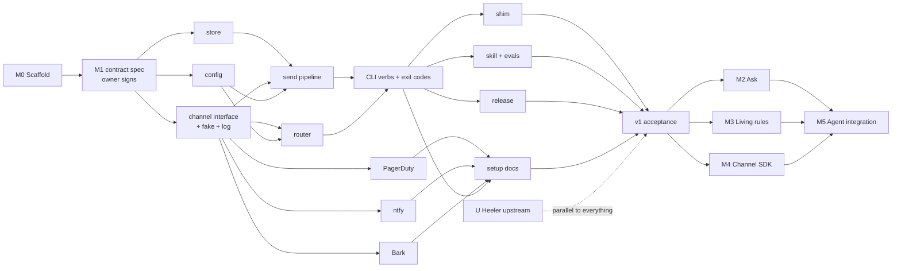

# yo-human roadmap: build order and parallel work

Status: draft for owner review, 2026-10-25. Replaces the milestone list in [2026-10-26-plan.md](2026-10-26-plan.md). Follows the [constitution](../../constitution.md), the [design](../specs/2026-10-26-yo-human-design.md) and the owner decisions (#2–#10). Each milestone gets its own writing-plans plan before work starts; this file only orders them.

## The rule that makes parallel work possible

**Contracts first, then fan out.** Work runs in parallel only where an interface between the pieces is already fixed and merged. Every milestone starts with one short serial step that writes those interfaces (a spec the owner signs, then the Go interface types), and only then splits into lanes. Lanes that touch the same files (`Makefile`, `ci.yml`) are developed in parallel but land one at a time, rebased in order.

## Order at a glance

## M0 Scaffold

Detailed plan: [2026-10-25-m0-scaffold.md](2026-10-25-m0-scaffold.md). No product code: a `version` command so every gate has something real to check.

| Wave | Tasks | Parallel? |
|---|---|---|
| 1 | T1 module, `version` command, Makefile | serial (everything builds on it) |
| 2 | T2 CI skeleton + vendored workflow lint | serial (later tasks add jobs to it) |
| 3 | T3 lint and limits · T4 coverage ratchet · T5 perf ratchet · T6 secret scan · T7 pre-commit · T8 repo docs and templates | **6 lanes in parallel**; land in this order to keep `Makefile`/`ci.yml` rebases trivial |
| 4 | T9 branch protection with the final check names | serial, owner confirms |

## M1 v1 Notify (the off-hours guardian)

Gets its own plan once the contract spec is signed. Issue-level breakdown:

| Wave | Work | Depends on | Parallel? |
|---|---|---|---|
| A | **M1.0 contract spec** (superpowers brainstorming with the owner): CLI verbs and flags, the exit-code table, `--json` shapes, the message model (level, title, body, project, agent, human, dedup key), config file format and secret references, store layout, the `Channel` interface and the closed capability set, quiet-hours semantics | M0 | serial, **owner signs** |
| B | **store** (queue, dedup keys, delivery state, dead letter; atomic writes under a lock) · **channel interface** (types, capability set, a fake channel for tests, the local log channel) · **config** (load, validate, secret references, deadline default 1 s, quiet hours) | A | **3 lanes** |
| C | **send pipeline** (enqueue first, flush-first, inline send under the deadline, bounded retry with backoff, dead letter) · **router** (level and project to channel order, quiet hours, capability match) · **PagerDuty** (Events v2 trigger/resolve, dedup_key, urgency) · **ntfy** (priority, tags, scheduled delivery) · **Bark** (levels including critical) | B (router and channels need only the channel interface and config) | **5 lanes** |
| D | **CLI**: `notify`, `resolve`, `status`, `flush`, `--json`, exit codes; perf budgets for the queued path and `status` | C (pipeline, router) | serial |
| E | **shim** (the old script's flags, `--resolve`) · **agent skill** with before/after evals · **setup docs** per channel (inputs-first, DRY, with a docs lint) · **release** (goreleaser, checksums, `v0.1.0`) | D (setup docs also need each channel) | **4 lanes** |
| F | **v1 acceptance**: end-to-end against fakes; independent security review of secrets, isolation and inbound; owner live smoke (PagerDuty, ntfy, Bark on a real phone, silent switch on and Focus active); migrate the existing callers | E | serial, owner |

Peak parallelism: 5 lanes in wave C. Critical path: M0 → A → store → pipeline → CLI → shim → F.

## U Heeler upstream (parallel to everything)

| Step | Work | Depends on |
|---|---|---|
| U0 | Open a discussion with the Heeler maintainer: the four upstream changes and the Critical Alerts entitlement | nothing |
| U1 | Owner runs `/install-github-app` on the planned Heeler fork | nothing (owner action) |
| U2 | The guarded daily fork-sync workflow (summary issue plus sync PR, never merges; SHA-pinned, hosted runners, no `pull_request_target`) | U1 |
| U3–U6 | One upstream PR each: agent-authored messages with levels · time-sensitive interruption level · notification actions · reply from notification | U0 (maintainer agrees to the direction); independent of each other |

v1 does not wait on any U step (decision #6).

Heeler is not a v1 channel (owner, 2026-10-27, constitution v1.0.2): the
design moved beyond it. It stays a candidate later channel for its own
strength, a human reaching agents directly while on the move.
[docs/research/2026-10-26-heeler.md](../research/2026-10-26-heeler.md) is the
reference.

## After v1: epics (planned when v1 ships)

| Milestone | Needs from v1 | Parallel with |
|---|---|---|
| **M2 Ask**: `ask`/`wait`, a channel-neutral question store, herdr question sessions, answer relay, reply authenticity | store, CLI contract | M3, M4 |
| **M3 Living rules**: scoped and expiring rules and context, back-signals, dry-run, the setup-conversation skill, escalation mechanisms | config, router | M2, M4 |
| **M4 Channel SDK**: manifest, out-of-process plugins with only their own secrets and a host allowlist, checksums, URL shorthand, quality tiers; **Pushover** as the first SDK channel | channel interface | M2, M3 |
| **M5 Agent integration**: crewkit plugin packaging, other runtimes through the CLI; MCP only if a runtime needs it | M2–M4 settle the CLI | after them |

## How this becomes GitHub issues

- One **epic issue per milestone** (M0, M1, U, M2–M5), in its milestone.
- One **sub-issue per task or wave item** above, using GitHub's native sub-issues, labelled `type:`, `area:`, `priority:`, `size:`.
- Every arrow in the chart is a native **"blocked by"** link. `status:ready` goes on issues with nothing open blocking them.
- M0 and M1 issues carry their plan task's text (files, interfaces, tests). M2–M5 are epics with only a few child issues each until they're planned.
- **Stacked PRs** follow the waves: within a wave each lane is its own branch off the wave's base; across waves the next wave branches from the merged result.

## Owner actions on the path

- Sign the M1 contract spec (wave A).
- Confirm branch protection (M0 T9).
- Live smoke test on a real phone (wave F).
- Install the Claude GitHub App on the Heeler fork (U1).
